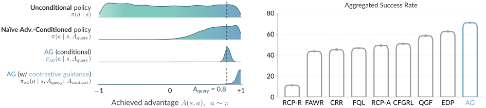

-

# Reinforcement Learning via Advantage Guidance

## [[Paper]](https://arxiv.org/abs/2610.19783)   [[Website]](https://advantage-guidance.github.io/)



## Overview

Advantage Guidance (AG) a new off-policy RL algorithm that trains with a **simple supervised learning loss** conditioned on advantages, yet **outperforms** strong RL methods. The key is to make the policy genuinely responsive to advantage conditioning, then use contrastive diffusion guidance at sampling time for advantage maximization. 

This repository contains AG and the baselines used in our OGBench and OCBench comparison. The implementation is in [`agents/advantage_guidance.py`](agents/advantage_guidance.py).

## Installation

**With uv (recommended):**

```bash
uv venv --python 3.11
uv sync
```

**With pip:**

```bash
python3.11 -m venv .venv
source .venv/bin/activate
pip install -r requirements.txt
```

## Environments and Datasets

The paper experiments use simulated environments from [OGBench](https://github.com/seohongpark/ogbench) and [OCBench](https://github.com/seohongpark/ocbench). There are also other environment types supported under `envs/`, such as exorl, d4rl, and robomimic, though they are not used in the paper. 

### OGBench

The paper uses `cube-single`, `cube-double`, `scene`, and `puzzle-3x3`, with tasks 1–5  
for each family. The default 1M datasets will be automatically downloaded to `~/.ogbench/data`. Sparse rewards are enabled by default. There is no need to set `--ogbench_dataset_dir`, which is only used for local sharded datasets.

### OCBench

The paper uses lite environments `block-single`, `block-double`, and `chamber-easy`. Although OCBench's official`make_env_and_datasets()` API downloads datasets automatically, our training code loads local shards directly, so download the datasets before training:

```bash
export OCBENCH_DATA_DIR="$HOME/.cache/ocbench/datasets"
uv run python - <<'PY'
import os
import ocbench

tasks = {
    "block-lite-single-task1-v0": 1,
    "block-lite-double-task1-v0": 3,
    "block-lite-double-task2-v0": 3,
    "chamber-lite-easy-task1-v0": 1,
    "chamber-lite-easy-task2-v0": 1,
    "chamber-lite-easy-task3-v0": 1,
}
for env_name, num_shards in tasks.items():
    ocbench.download_datasets(
        env_name,
        dataset_root=os.environ["OCBENCH_DATA_DIR"],
        num_shards=num_shards,
    )
PY
```

The downloader saves files under `$OCBENCH_DATA_DIR/lite/<env_name>/`. Each shard contains 10k trajectories. Our experiment script below set`--sparse=False` to retain OCBench's original sparse 0/1 rewards.

## Running a single experiment

All experiments are launched through `main.py`. The agent configuration is passed via `--agent=agents/<agent>.py` and all agent hyperparameters can be overridden with `--agent.<key>=<value>`.

### Advantage Guidance (our method)

For example, run AG on OGBench Puzzle 3×3 T1:

```bash
MUJOCO_GL=egl uv run python main.py \
  --agent=agents/advantage_guidance.py \
  --agent.num_imagined_actions=7 \
  --agent.residual_parameterization = True \
  --agent.adv_gaussian_std=0.1 \
  --guidance_weights=0,0.75,1,1.25,1.5,2,2.5,4 \
  --agent.action_chunking=True \
  --agent.horizon_length=5 \
  --env_name=puzzle-3x3-play-singletask-task1-v0 \
  --offline_steps=500000 \
  --eval_episodes=30 \
  --eval_vecenv_size=10 \
```

The `--guidance_weights` flag evaluates every listed weight at each evaluation interval and logs a separate success rate for  
each. Checkpoints are saved to  
`exp/advantage-guidance/<wandb_run_group>/<run_name>/params_<step>.pkl`, alongside CSV  
logs.

## Launching full paper experiments (via SLURM)

Each `scripts/exp_*.py` writes a submission wrapper to `sbatch/`. Run the wrapper with
`bash` to submit its SLURM array. The workers use
[GNU parallel](https://www.gnu.org/software/parallel/), so install it on your cluster.
Run these commands from the repository root with the environment installed above.

### Advantage Guidance

```bash

# OGBench
python scripts/exp_advantage_guidance.py --suite ogbench && bash sbatch/advantage_guidance_ogbench.sh

# OCBench (download the datasets first, as described above)
python scripts/exp_advantage_guidance.py --suite ocbench && bash sbatch/advantage_guidance_ocbench.sh
```

### Baselines

```bash
python scripts/exp_edp.py --suite ogbench && bash sbatch/edp_ogbench.sh
python scripts/exp_fql.py --suite ogbench && bash sbatch/fql_ogbench.sh
python scripts/exp_qgf.py --suite ogbench && bash sbatch/qgf_ogbench.sh
python scripts/exp_cfgrl.py --suite ogbench && bash sbatch/cfgrl_ogbench.sh
python scripts/exp_fawr.py --suite ogbench && bash sbatch/fawr_ogbench.sh
python scripts/exp_rcp_a.py --suite ogbench && bash sbatch/rcp_a_ogbench.sh
python scripts/exp_rcp_r.py --suite ogbench && bash sbatch/rcp_r_ogbench.sh
python scripts/exp_crr.py --suite ogbench && bash sbatch/crr_ogbench.sh
```

For OCBench, replace `--suite ogbench` with `--suite ocbench` and `_ogbench.sh` with  
`_ocbench.sh`. 

## Acknowledgments

This codebase builds on [Q-Guided Flow (QGF)](https://github.com/zhouzypaul/qgf),

## BibTeX

```bibtex
@article{zhou2026reinforcement,
  title   = {Reinforcement Learning via Advantage Guidance},
  author  = {Zhou, Zhiyuan and Levine, Sergey},
  journal = {arXiv preprint arXiv:2610.19783},
  year    = {2026},
  url     = {https://arxiv.org/abs/2610.19783}
}
```
